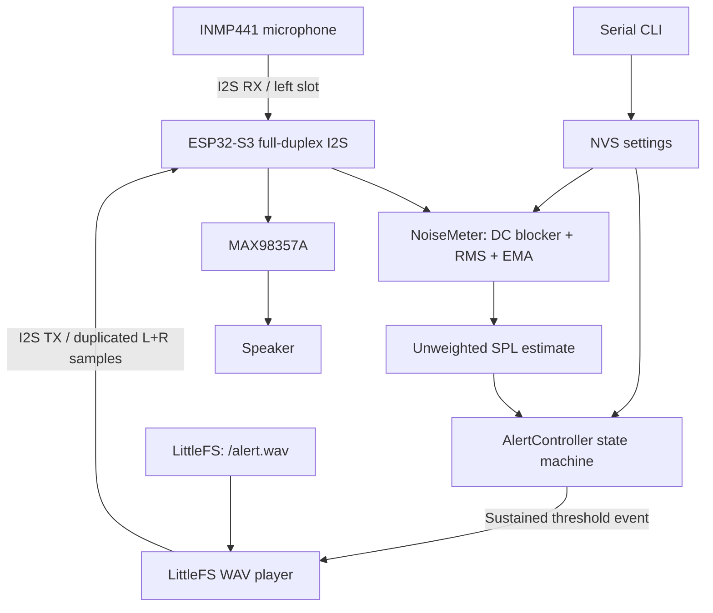

# Noise Monitor MVP — Version C

A local-only, battery-powered environmental noise monitor and reminder prototype built for the **Seeed Studio XIAO ESP32-S3**. The device samples ambient sound through an I2S MEMS microphone, estimates an unweighted sound-pressure level, and plays a local WAV reminder when the level remains above a configurable threshold.

**Project language:** English. Source code, comments, Serial Monitor messages, command names, and documentation are all in English.

**Target enclosure:** a plush toy approximately 20 cm tall.

> **Measurement limitation:** this MVP reports a calibrated *unweighted SPL estimate*. It does not implement IEC A-weighting or sound-level-meter time weighting, and it must not label its output as dBA or as a certified measurement.

---

## 1. Version C design decisions

Version C combines the compact audio architecture of Version A with selected development features from Version B.

| Area | Version C decision | Reason |
|---|---|---|
| I2S | One ESP32-S3 I2S controller with paired full-duplex TX/RX channels | Shared BCLK/WS; fewer signal wires and one clock domain |
| Audio format | 16 kHz, 32-bit stereo I2S slots | Compatible frame timing for the INMP441 input and MAX98357A output |
| Noise processing | 24-bit sample extraction, DC blocker, RMS, dBFS, EMA smoothing | More stable measurements than raw amplitude thresholding |
| Reminder policy | Hold timer, hysteresis, cooldown, and quiet-to-rearm | Prevents repeated reminders while noise remains high |
| Audio assets | LittleFS WAV file | Replace the reminder without recompiling the firmware |
| Settings | Serial CLI + NVS persistence | Tune threshold, calibration offset, and playback gain during development |
| Amplifier | MAX98357A SD_MODE controlled by a GPIO | Hardware shutdown while not playing |
| Status | XIAO onboard LED patterns | Simple visual feedback during testing |

The design is intentionally local-only. It does not connect to Wi-Fi, stream audio, store microphone recordings, or perform speech recognition.

## 2. MVP features

- Read ambient audio from an INMP441 I2S MEMS microphone.
- Extract the 24-bit microphone signal from 32-bit I2S slots.
- Apply a first-order DC-blocking high-pass filter.
- Calculate RMS and dBFS, then apply a configurable calibration offset.
- Smooth the reported level using an exponential moving average (EMA).
- Trigger after the threshold remains exceeded for a configured hold interval.
- Require a quiet interval after cooldown before the device can trigger again.
- Play a mono 16 kHz / 16-bit PCM WAV reminder through a MAX98357A amplifier, with a built-in chime fallback.
- Shut down the amplifier outside playback.
- Change settings using the Serial Monitor and persist them in NVS.
- Display runtime state using the onboard user LED.
- Report pack voltage, warn on a low battery, and enter a protective deep sleep below the cutoff.
- Fall back to a built-in three-note chime when the WAV asset is missing or unreadable.
- Run the CPU at 80 MHz; no WiFi or Bluetooth stack is ever initialised.

## 3. Hardware assumptions

| Component | Prototype selection | Role |
|---|---|---|
| MCU board | Seeed Studio XIAO ESP32-S3 | Control, I2S, DSP, NVS |
| Microphone | INMP441 I2S MEMS module | Ambient audio input |
| Amplifier | MAX98357A I2S Class-D breakout | Digital audio power stage |
| Speaker | 8 Ω miniature speaker, rated for the expected amplifier output | Voice/chime output |
| Battery | Protected single-cell 3.7 V Li-Po compatible with the XIAO battery input | Portable power |
| Voltage divider | 2 × 100 kΩ, 1 % | Pack voltage sense on D1 (`BAT+` → D1 → GND) |

The INMP441 is retained for prototype compatibility, but the manufacturer currently lists it as obsolete. If it has not yet been purchased, select a currently supported I2S MEMS microphone and verify its slot format and sample alignment before using this firmware unchanged.

Read [Hardware and Wiring](docs/HARDWARE.md) before connecting modules. The amplifier is powered from the protected battery rail in the recommended wiring, not from the XIAO 5V pin while running on battery.

## 4. System architecture



### Audio clocking

The ESP32-S3 configures one I2S controller with paired TX and RX channels. Both channels share BCLK and WS and use 16 kHz, 32-bit stereo frames. The INMP441 is strapped to the left slot. The firmware reads interleaved stereo frames and processes only the left sample. The WAV player duplicates each mono sample into both transmit slots so the MAX98357A channel-selection strap does not affect the reminder content.

### Alert state machine

```text
MONITORING
    | level >= trigger threshold
    v
THRESHOLD_HOLD -- level < reset threshold --> MONITORING
    |
    | hold duration reached
    v
PLAYING_ALERT
    |
    | playback attempt finished
    v
COOLDOWN
    |
    | cooldown elapsed
    v
WAITING_FOR_QUIET
    | level > reset threshold: quiet timer resets
    | level <= reset threshold continuously for quiet-rearm period
    v
MONITORING
```

This distinction is important: after cooldown, the controller does **not** re-arm while the room remains noisy. A sustained noisy environment therefore does not cause reminders to repeat every cooldown interval.

## 5. Repository layout

```text
noise-monitor-version-c/
├── platformio.ini
├── partitions.csv
├── README.md
├── LICENSE
├── include/
│   ├── alert_controller.h
│   ├── alert_sound.h
│   ├── audio_bus.h
│   ├── battery_monitor.h
│   ├── calibration.h
│   ├── config.h
│   ├── noise_meter.h
│   ├── wav_parser.h
│   └── wav_player.h
├── src/
│   ├── alert_controller.cpp
│   ├── alert_sound.cpp
│   ├── audio_bus.cpp
│   ├── battery_monitor.cpp
│   ├── calibration.cpp
│   ├── main.cpp
│   ├── noise_meter.cpp
│   ├── wav_parser.cpp
│   └── wav_player.cpp
├── data/
│   └── alert.wav
├── docs/
│   ├── ARCHITECTURE_DECISIONS.md
│   ├── PATCH_NOTES.md
│   ├── VALIDATION_STATUS.md
│   ├── HARDWARE.md
│   ├── FIRMWARE.md
│   └── CALIBRATION_AND_TESTING.md
├── tests/
│   ├── test_alert_controller.cpp
│   ├── test_calibration.cpp
│   └── test_wav_parser.cpp
└── tools/
    ├── generate_test_tone.py
    └── run_host_tests.sh
```

## 6. Development environment

- Visual Studio Code.
- PlatformIO IDE extension or PlatformIO Core CLI.
- PlatformIO platform `espressif32@8.0.0` (Arduino-ESP32 Core 3.3.12 / ESP-IDF 5.5.5).
- A USB data cable for firmware upload and Serial Monitor.

The `platformio.ini` pins `espressif32@8.0.0`, which bundles Arduino-ESP32 Core 3.3.12 (based on ESP-IDF 5.5.5). The native standard I2S driver (`driver/i2s_std.h`) is required by this firmware. Keeping the platform version pinned makes builds reproducible across development machines.

## 7. Build, upload, and run

Open the project folder (the folder containing `platformio.ini`) in VS Code.

```bash
# Compile firmware
pio run

# Upload firmware to the XIAO ESP32-S3
pio run -t upload

# Upload data/alert.wav to the LittleFS partition
pio run -t uploadfs

# Open Serial Monitor
pio device monitor -b 115200
```

The first firmware upload and the filesystem upload are separate operations. Repeat `uploadfs` after replacing `data/alert.wav`; a normal firmware upload does not update the filesystem image.

### Test audio

A short, quiet three-note test chime is included at `data/alert.wav`. To regenerate it:

```bash
python tools/generate_test_tone.py
pio run -t uploadfs
```

To use a spoken reminder, replace `data/alert.wav` with a mono, 16 kHz, 16-bit PCM WAV file. A suggested original prompt is: “Please keep the noise down. Thank you.” Avoid stereo, compressed WAV formats, or other sample rates; the player validates the format and will refuse unsupported files.

## 8. Serial commands

Open the Serial Monitor at **115200 baud**. Send commands with a newline ending.

| Command | Example | Purpose |
|---|---|---|
| `HELP` | `HELP` | Show commands |
| `STATUS` | `STATUS` | Show state and active settings |
| `SET_THRESH <dB>` | `SET_THRESH 70` | Set trigger threshold (40–110) |
| `SET_RESET <dB>` | `SET_RESET 65` | Set reset threshold (30–109; must be below trigger) |
| `SET_CAL <dB>` | `SET_CAL 3.5` | Set calibration offset (−20…+20) |
| `SET_VOL <gain>` | `SET_VOL 0.25` | Set digital playback gain (0.05–0.65) |
| `TEST_ALERT` | `TEST_ALERT` | Play the reminder now (WAV, or the built-in chime) |

Changes are saved to ESP32 NVS and retained across reset or loss of power. `SET_THRESH` and `SET_RESET` must preserve `reset < trigger`.

The hold, cooldown, and quiet-rearm durations are compiled defaults in `include/config.h` for this MVP. They are not exposed as runtime commands yet.

## 9. Default configuration

| Setting | Default | Meaning |
|---|---:|---|
| Sample rate | 16,000 Hz | I2S microphone and speaker rate |
| I2S slots | 32-bit stereo, BOTH slots selected for TX and RX | TX sends duplicated L/R samples; RX retains interleaved frames and processes the microphone's left slot |
| Audio block | 512 frames | 32 ms per acquisition block |
| Trigger threshold | 70 dB estimate | Starts a candidate alert |
| Reset threshold | 65 dB estimate | Cancels a pending hold / qualifies for re-arm |
| Threshold hold | 3,000 ms | Required sustained high-noise time |
| Cooldown | 30,000 ms | Minimum time after a playback attempt |
| Quiet re-arm | 2,000 ms | Required continuous quiet after cooldown |
| Post-playback discard | 500 ms | Flush microphone DMA data after speaker playback |
| CPU frequency | 80 MHz | Enough for 16 kHz DSP; lowers idle current |
| Battery check interval | 10 s | Pack voltage is sampled and averaged |
| Low battery | 3.50 V | LED double-blink pattern and one Serial warning |
| Critical battery | 3.30 V | Protective deep sleep, re-checked every 10 minutes |
| Playback gain | 0.25 | Conservative software starting value |
| dBFS full-scale reference | 120 dB SPL | From the INMP441 −26 dBFS @ 94 dB SPL sensitivity |
| Calibration offset | 0 dB | Enclosure correction; measure it against a reference meter |

All values are starting points for bench testing, not universal public-space settings.

## 10. Measurement limitation

The microphone provides PCM samples, not dB values. Version C calculates RMS, converts it to dBFS, then adds a calibration offset:

```text
dBFS = 20 * log10(RMS)
SPL_estimate = dBFS + 120 dB + calibration_offset
```

The 120 dB term is the microphone's full-scale reference (−26 dBFS at 94 dB SPL). The calibration offset is the only user-adjustable part and covers ±20 dB.

The firmware applies DC removal and temporal smoothing. It does **not** implement A-weighting, C-weighting, IEC time weighting, or the full performance requirements of a sound level meter. The serial label is therefore `SPL_est` / `unweighted`, not `dBA`. A single calibration offset is only a prototype correction; use a reference sound level meter and test several levels and frequencies before relying on the estimate.

See [Calibration and Testing](docs/CALIBRATION_AND_TESTING.md) and [Review Hardening Patch Notes](docs/PATCH_NOTES.md).

## 11. Safety and enclosure notes

- Use a protected, undamaged single-cell Li-Po battery with the correct connector and polarity for the exact XIAO board revision.
- Do not solder directly to a bare pouch cell. Use a pre-terminated protected battery assembly and an appropriate connector.
- Keep the battery in a rigid, removable compartment so it cannot be compressed, punctured, twisted, or pulled by wires inside the plush toy.
- Do not charge the battery while the electronics are buried in plush filling or leave a prototype charging unattended.
- The XIAO 5V/VBUS pin is not a battery-boost output; it is not available as a 5 V rail when the board is powered only from its Li-Po battery.
- Keep the microphone acoustic port exposed and separate it from the speaker opening.
- The MAX98357A speaker outputs are bridge-tied. Connect the speaker only between `SPK+` and `SPK-`; do not connect either speaker terminal to GND.
- Begin with low speaker gain and verify actual loudness and temperature. A software gain value alone does not certify speaker power handling.

## 12. Troubleshooting

| Symptom | First checks |
|---|---|
| I2S initialization fails | Verify board target, pinned `espressif32@8.0.0` platform, GPIO map, and common ground |
| Microphone level stays at the noise floor | Check INMP441 3.3 V, GND, SCK, WS, SD, and L/R-to-GND wiring |
| Level changes but looks unrealistic | Confirm 24-bit alignment, left-slot selection, microphone orientation, and calibration |
| Speaker is silent | Check amplifier VIN/GND, SD_MODE, BCLK/WS/DIN, and speaker wiring; the firmware should still fall back to the built-in chime, so a silent fallback points at the I2S output rather than the WAV file |
| Chime plays but the spoken reminder does not | `/alert.wav` is missing or not the required format; check the boot log and `STATUS` for the active reminder source |
| Battery always reads 0 V or absent | The 100 kΩ / 100 kΩ divider is not fitted, or the mid-point is not on D1 |
| Audio is distorted | Reduce `SET_VOL`, check supply stability, and verify the speaker rating and amplifier breakout gain strap |
| Alert repeats while the room remains noisy | Confirm firmware is in `WAITING_FOR_QUIET`; it should not re-arm until the reset threshold remains satisfied for the quiet-rearm interval |
| Device reacts to its own reminder | Confirm monitor processing is paused during playback and post-playback samples are discarded |
| Settings revert after restart | Check NVS partition and Serial output for `[NVS]` save/load errors |

## 13. Host-side logic test

The alert state machine is independent of Arduino hardware and can be tested on a computer with a C++17 compiler:

```bash
bash tools/run_host_tests.sh
```

This verifies sustained triggering, cancellation, cooldown, quiet-to-rearm behavior, and `millis()` rollover arithmetic. It does not replace a firmware build or hardware test.

## 14. Validation status

The host-side alert-controller, WAV-parser, and calibration test suites pass. The battery, chime-fallback, and power changes added in the P0 pass have been syntax-checked against stub Arduino headers but not compiled with PlatformIO or exercised on hardware. A target build and physical tests are still required. See [Validation Status](docs/VALIDATION_STATUS.md) before flashing or wiring the battery-powered prototype.

## 15. Reference links

- [Seeed Studio XIAO ESP32-S3 Getting Started](https://wiki.seeedstudio.com/xiao_esp32s3_getting_started/)
- [ESP-IDF I2S Standard Mode — ESP32-S3](https://docs.espressif.com/projects/esp-idf/en/stable/esp32s3/api-reference/peripherals/i2s.html)
- [Arduino-ESP32 Preferences API](https://docs.espressif.com/projects/arduino-esp32/en/latest/api/preferences.html)
- [Analog Devices MAX98357A](https://www.analog.com/en/products/max98357a.html)
- [TDK INMP441 product information](https://product.tdk.com/en/search/sw_piezo/mic/mems-mic/info?part_no=INMP441)
