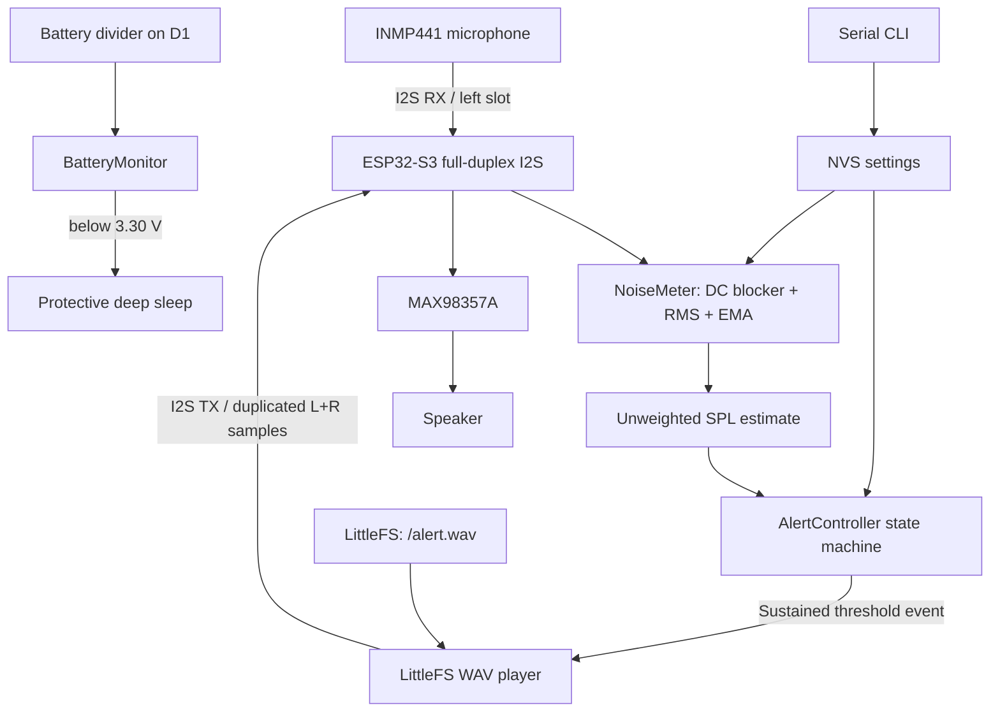

# Noise Monitor MVP — Version C

A local-only, battery-powered environmental noise monitor and reminder prototype built for the **Seeed Studio XIAO ESP32-S3**. The device samples ambient sound through an I2S MEMS microphone, estimates an unweighted sound-pressure level, and plays a local WAV reminder when the level remains above a configurable threshold.

**Project language:** English. Source code, comments, Serial Monitor messages, command names, and documentation are all in English.

**Target enclosure:** a plush toy approximately 20 cm tall.

> **Measurement limitation:** this MVP reports a calibrated *unweighted SPL estimate*. It does not implement IEC A-weighting or sound-level-meter time weighting, and it must not label its output as dBA or as a certified measurement.

---

## 1. What it does

- Reads ambient audio from an INMP441 I2S MEMS microphone and extracts the 24-bit payload from 32-bit I2S slots.
- Applies a first-order DC blocker, computes RMS and dBFS, adds a calibration offset, and smooths the result with an exponential moving average.
- Triggers a reminder after the level stays above the trigger threshold for a hold interval.
- Requires a sustained quiet interval after cooldown before it can trigger again, so a permanently noisy room does not produce a reminder every cooldown period.
- Plays a mono 16 kHz / 16-bit PCM WAV from LittleFS through a MAX98357A amplifier, with a built-in three-note chime as a fallback.
- Keeps the amplifier in hardware shutdown outside playback.
- Accepts configuration over the Serial Monitor and persists it in NVS.
- Reports pack voltage, warns on a low battery, and enters a protective deep sleep below the cutoff.
- Runs the CPU at 80 MHz. No Wi-Fi or Bluetooth stack is ever initialised, and the firmware never connects to a network, records audio, or performs speech recognition.

## 2. Hardware

| Component | Prototype selection | Role |
|---|---|---|
| MCU board | Seeed Studio XIAO ESP32-S3 | Control, I2S, DSP, NVS |
| Microphone | INMP441 I2S MEMS module | Ambient audio input |
| Amplifier | MAX98357A I2S Class-D breakout | Digital audio power stage |
| Speaker | 8 Ω miniature speaker, rated for the expected amplifier output | Voice/chime output |
| Battery | Protected single-cell 3.7 V Li-Po compatible with the XIAO battery input | Portable power |
| Voltage divider | 2 × 100 kΩ, 1 % | Pack voltage sense on D1 (`BAT+` → D1 → GND) |

The INMP441 is retained for prototype compatibility, but the manufacturer currently lists it as obsolete. If it has not yet been purchased, select a currently supported I2S MEMS microphone and verify its slot format and sample alignment before using this firmware unchanged.

**[docs/HARDWARE.md](docs/HARDWARE.md)** carries the pin map, the battery divider, supply rules, the plush-enclosure layout and the bring-up order. Read it before connecting modules: the amplifier is powered from the protected battery rail, not from the XIAO 5V pin.

## 3. Architecture



**Audio clocking.** One ESP32-S3 I2S controller drives paired TX and RX channels that share BCLK and WS, using 16 kHz 32-bit stereo frames. The INMP441 is strapped to the left slot; the firmware reads interleaved stereo frames and processes only the left word. The WAV player duplicates each mono sample into both transmit slots, so the MAX98357A channel-selection strap cannot change the reminder content.

**Alert state machine.**

```text
MONITORING
    | level >= trigger threshold
    v
THRESHOLD_HOLD -- level < reset threshold --> MONITORING
    |
    | hold duration reached
    v
PLAYING_ALERT
    |
    | playback attempt finished
    v
COOLDOWN
    |
    | cooldown elapsed
    v
WAITING_FOR_QUIET
    | level > reset threshold: quiet timer resets
    | level <= reset threshold continuously for the quiet-rearm period
    v
MONITORING
```

The reset threshold is deliberately lower than the trigger threshold, which creates hysteresis. The important detail is that cooldown expiry alone never re-arms the controller: a quiet interval is also required.

**[docs/FIRMWARE.md](docs/FIRMWARE.md)** describes every module, the DSP pipeline, the I2S configuration constraints, the NVS keys, the LED patterns and the design trade-offs behind them.

## 4. Repository layout

```text
noise-monitor/
├── platformio.ini            PlatformIO target, framework, filesystem and compiler flags
├── partitions.csv            8 MB flash layout: NVS, otadata, two app slots, LittleFS, coredump
├── README.md                 This file: overview, build, commands, defaults, known issues
├── LICENSE                   MIT
├── include/
│   ├── config.h              GPIO map, audio format, DSP constants, battery thresholds, defaults
│   ├── calibration.h         dBFS-to-SPL reference, offset limits, NVS value interpretation
│   ├── audio_bus.h           Full-duplex I2S API
│   ├── noise_meter.h         Measurement interface and NoiseReading structure
│   ├── alert_controller.h    Alert state machine interface
│   ├── alert_sound.h         WAV-or-chime reminder selection
│   ├── battery_monitor.h     Pack voltage sampling and status classification
│   ├── wav_parser.h          Platform-independent seekable WAV reader and parsed PCM metadata
│   └── wav_player.h          LittleFS WAV playback interface
├── src/
│   ├── main.cpp              Startup, NVS, Serial CLI, battery policy, telemetry and LED
│   ├── audio_bus.cpp         ESP-IDF I2S TX/RX, amplifier control and PCM output
│   ├── noise_meter.cpp       INMP441 extraction, DC block, RMS, dBFS and EMA
│   ├── alert_controller.cpp  Hold, hysteresis, cooldown and quiet-to-rearm policy
│   ├── alert_sound.cpp       Three-note chime synthesiser and fallback selection
│   ├── battery_monitor.cpp   ADC averaging, thresholds and state-of-charge curve
│   ├── calibration.cpp       Legacy NVS calibration conversion and clamping
│   ├── wav_parser.cpp        RIFF/WAVE chunk parser with overflow-safe bounds checks
│   └── wav_player.cpp        LittleFS adapter and chunked I2S playback
├── data/
│   └── alert.wav             Test chime; replace with a spoken prompt if desired
├── docs/
│   ├── HARDWARE.md           Wiring, supply, battery and enclosure guidance
│   ├── FIRMWARE.md           Module reference, DSP, state machine, power policy, trade-offs
│   └── TESTING.md            Bring-up sequence, calibration, host tests, validation status
├── tests/
│   ├── test_alert_controller.cpp   State-machine boundary and timing tests
│   ├── test_wav_parser.cpp         Valid and malformed RIFF/WAV chunk tests
│   └── test_calibration.cpp        Legacy conversion, clamping and idempotence tests
└── tools/
    ├── generate_test_tone.py       Regenerate data/alert.wav
    └── run_host_tests.sh           Build and run the three host-side test programs
```

## 5. Build, upload, and run

Open the project folder (the one containing `platformio.ini`) in VS Code with the PlatformIO extension, or use PlatformIO Core from the command line.

```bash
# Compile firmware
pio run

# Upload firmware to the XIAO ESP32-S3
pio run -t upload

# Upload data/alert.wav to the LittleFS partition
pio run -t uploadfs

# Open Serial Monitor
pio device monitor -b 115200
```

`pio run` must be executed in the directory that contains `platformio.ini`; PlatformIO does not search parent directories.

The firmware upload and the filesystem upload are separate operations. Repeat `uploadfs` after replacing `data/alert.wav`; a normal firmware upload does not update the filesystem image.

### Toolchain

`platformio.ini` pins `espressif32@8.0.0`, the official `platformio/espressif32` platform released 2026-10-19. It bundles Arduino-ESP32 Core 3.3.12 (based on ESP-IDF 5.5.5) and requires PlatformIO Core 6.x. The native standard I2S driver (`driver/i2s_std.h`) is required by this firmware, so the platform version is pinned for reproducible builds.

The first build downloads the platform and the Xtensa toolchain (several hundred MB) into `~/.platformio`. Build output goes to `.pio/build/seeed_xiao_esp32s3/`, which is git-ignored.

### Test audio

A short, quiet three-note test chime is included at `data/alert.wav` (mono, 16 kHz, 16-bit, 1.15 s). To regenerate it:

```bash
python tools/generate_test_tone.py
pio run -t uploadfs
```

To use a spoken reminder, replace `data/alert.wav` with a mono, 16 kHz, 16-bit PCM WAV file. A suggested original prompt is: “Please keep the noise down. Thank you.” Avoid stereo, compressed WAV formats, or other sample rates; the player validates the format and refuses unsupported files, falling back to the built-in chime.

## 6. Serial commands

Open the Serial Monitor at **115200 baud**. Send commands with a newline ending. Command names are case-insensitive.

| Command | Example | Purpose |
|---|---|---|
| `HELP` | `HELP` | Show commands |
| `STATUS` | `STATUS` | Show state, settings, battery and active reminder source |
| `SET_THRESH <dB>` | `SET_THRESH 70` | Set trigger threshold (40–110) |
| `SET_RESET <dB>` | `SET_RESET 65` | Set reset threshold (30–109; must be below trigger) |
| `SET_CAL <dB>` | `SET_CAL 3.5` | Set calibration offset (−20…+20) |
| `SET_VOL <gain>` | `SET_VOL 0.25` | Set digital playback gain (0.05–0.65) |
| `TEST_ALERT` | `TEST_ALERT` | Play the reminder now (WAV, or the built-in chime) |

Changes are written to ESP32 NVS immediately and retained across reset or loss of power. `SET_THRESH` and `SET_RESET` must preserve `reset < trigger`, otherwise the command is rejected.

`TEST_ALERT` also starts the normal cooldown, so a manual test suppresses automatic alerts for the cooldown duration. See [Known issues](#11-known-issues).

The hold, cooldown, and quiet-rearm durations are compiled constants in `include/config.h`. They are not exposed as runtime commands.

## 7. Default configuration

| Setting | Default | Meaning |
|---|---:|---|
| Sample rate | 16,000 Hz | I2S microphone and speaker rate |
| I2S slots | 32-bit stereo, `I2S_STD_SLOT_BOTH` on TX and RX | TX sends duplicated L/R samples; RX keeps interleaved frames and the firmware reads the microphone's left slot |
| Audio block | 512 frames | 32 ms per acquisition block |
| Trigger threshold | 70 dB estimate | Starts a candidate alert |
| Reset threshold | 65 dB estimate | Cancels a pending hold / qualifies as quiet |
| Threshold hold | 3,000 ms | Required sustained high-noise time |
| Cooldown | 30,000 ms | Minimum time after a playback attempt |
| Quiet re-arm | 2,000 ms | Required continuous quiet after cooldown |
| Post-playback discard | 500 ms | Flush microphone DMA data after speaker playback |
| CPU frequency | 80 MHz | Sufficient for 16 kHz DSP; lowers idle current |
| Playback gain | 0.25 | Conservative software starting value |
| Amplifier wake delay | 15 ms | Settling time after enabling the MAX98357A |
| Battery check interval | 10 s | Pack voltage is sampled and averaged over 16 readings |
| Low battery | 3.50 V | LED double-blink and one Serial warning per episode |
| Critical battery | 3.30 V | Protective deep sleep, re-checked every 10 minutes |
| Battery absent | below 2.50 V | Treated as USB power, no warning |
| dBFS full-scale reference | 120 dB SPL | From the INMP441 −26 dBFS @ 94 dB SPL sensitivity |
| Calibration offset | 0 dB | Enclosure correction; measure it against a reference meter |

All values are starting points for bench testing, not universal public-space settings.

## 8. Measurement model and limits

The microphone provides PCM samples, not dB values. The firmware computes RMS, converts it to dBFS, then adds a calibration offset:

```text
dBFS = 20 * log10(RMS)
SPL_estimate = dBFS + 120 dB + calibration_offset
```

The 120 dB term is the microphone's full-scale reference and is fixed in `include/calibration.h`. The calibration offset is the only user-adjustable part and covers ±20 dB.

The firmware applies DC removal and temporal smoothing. It does **not** implement A-weighting, C-weighting, IEC time weighting, or the performance requirements of a sound level meter. The serial label is therefore `SPL_est` / `unweighted`, not `dBA`. A single calibration offset is only a prototype correction; use a reference sound level meter at several levels and frequencies before relying on the estimate. The full procedure is in [docs/TESTING.md](docs/TESTING.md).

## 9. Troubleshooting

| Symptom | First checks |
|---|---|
| I2S initialization fails | Verify board target, the pinned `espressif32@8.0.0` platform, GPIO map, and common ground |
| Microphone level stays at the noise floor | Check INMP441 3.3 V, GND, SCK, WS, SD, and L/R-to-GND wiring |
| Level changes but looks unrealistic | Confirm 24-bit alignment, left-slot selection, microphone orientation, and calibration |
| Speaker is silent | Check amplifier VIN/GND, SD_MODE, BCLK/WS/DIN, and speaker wiring; the firmware should still fall back to the built-in chime, so a silent fallback points at the I2S output rather than the WAV file |
| Chime plays but the spoken reminder does not | `/alert.wav` is missing or not the required format; check the boot log and `STATUS` for the active reminder source |
| Battery always reads absent | The 100 kΩ / 100 kΩ divider is not fitted, or the mid-point is not on D1 |
| Audio is distorted | Reduce `SET_VOL`, check supply stability, and verify the speaker rating and amplifier breakout gain strap |
| Alert repeats while the room remains noisy | Confirm firmware is in `WAITING_FOR_QUIET`; it does not re-arm until the reset threshold holds for the quiet-rearm interval |
| Device reacts to its own reminder | Confirm microphone processing is paused during playback and post-playback samples are discarded |
| Settings revert after restart | Check NVS partition and Serial output for `[NVS]` save/load errors |
| `pio run` reports an unknown board | Run `pio boards xiao` and confirm `seeed_xiao_esp32s3` exists in the pinned platform |

## 10. Testing and validation status

The three host-side test programs build with `-Wall -Wextra -Werror -pedantic` and pass:

```bash
bash tools/run_host_tests.sh
```

They cover the alert state machine (including `millis()` rollover), the RIFF/WAV parser (including hostile chunk sizes), and the calibration conversion. They do not cover I2S, LittleFS, the microphone, the amplifier or the speaker.

**Target build:** `pio run` passes with `espressif32@8.0.0` (Arduino-ESP32 3.3.12, ESP-IDF 5.5.5, Xtensa GCC 14.2.0): RAM 8.3 %, flash 13.3 %. No hardware has been connected yet, so I2S, the microphone, the amplifier, the speaker and the battery divider remain unverified.

See [docs/TESTING.md](docs/TESTING.md) for the bring-up sequence, the calibration procedure, the acceptance checklist and the exact list of behaviour that still needs bench confirmation.

## 11. Known issues

These are known inconsistencies in the current source, recorded here so they are not rediscovered as surprises.

1. **`calibration::normalizeStoredOffset()` is not on the device path.** `main.cpp` (`loadSettings()`) reimplements the same legacy-to-offset conversion inline, so the host-tested function in `src/calibration.cpp` has no firmware caller. A change to one will not affect the other until they are unified.
2. **`TEST_ALERT` starts the cooldown.** A manual playback also calls `AlertController::onPlaybackCompleted()`, which moves the state machine to `COOLDOWN` and suppresses automatic alerts for 30 s plus the quiet-rearm interval.
3. **Unused accessors.** `audio_bus::isReady()` and `AlertController::holdDurationMs()`, `cooldownDurationMs()`, `quietRearmDurationMs()` have no callers; they exist for interface completeness.
4. **Hard-coded silence tail.** `src/wav_player.cpp` passes `40` to `writeSilence()` instead of using `config::kChimeTailMs`, so the two playback paths have separate sources for the same value.
5. **No `phy_init` partition.** `partitions.csv` omits it, which is harmless while no RF stack is initialised. Adding Wi-Fi or Bluetooth later requires a partition-table change.
6. **INMP441 output is tri-stated outside its slot.** With RX configured for both slots, the right slot samples a floating data line. The firmware ignores it, but a 100 kΩ pull-down on the data line removes the ambiguity.

## 12. Safety and enclosure notes

- Use a protected, undamaged single-cell Li-Po battery with the correct connector and polarity for the exact XIAO board revision.
- Do not solder directly to a bare pouch cell. Use a pre-terminated protected battery assembly.
- Keep the battery in a rigid, removable compartment so it cannot be compressed, punctured, twisted, or pulled by wires inside the plush toy.
- Do not charge the battery while the electronics are buried in plush filling, and do not leave a prototype charging unattended.
- The XIAO 5V/VBUS pin is not a battery-boost output; it is not available as a 5 V rail when the board is powered only from its Li-Po battery.
- Keep the microphone acoustic port exposed and separate it from the speaker opening.
- The MAX98357A speaker outputs are bridge-tied. Connect the speaker only between `SPK+` and `SPK-`; do not connect either speaker terminal to GND.
- Start with low speaker gain and verify actual loudness and temperature. A software gain value alone does not certify speaker power handling.

Detailed placement guidance for the plush enclosure is in [docs/HARDWARE.md](docs/HARDWARE.md).

## 13. Reference links

- [Seeed Studio XIAO ESP32-S3 Getting Started](https://wiki.seeedstudio.com/xiao_esp32s3_getting_started/)
- [ESP-IDF I2S Standard Mode — ESP32-S3](https://docs.espressif.com/projects/esp-idf/en/stable/esp32s3/api-reference/peripherals/i2s.html)
- [Arduino-ESP32 Preferences API](https://docs.espressif.com/projects/arduino-esp32/en/latest/api/preferences.html)
- [PlatformIO espressif32 platform](https://registry.platformio.org/platforms/platformio/espressif32)
- [Analog Devices MAX98357A](https://www.analog.com/en/products/max98357a.html)
- [TDK INMP441 product information](https://product.tdk.com/en/search/sw_piezo/mic/mems-mic/info?part_no=INMP441)
